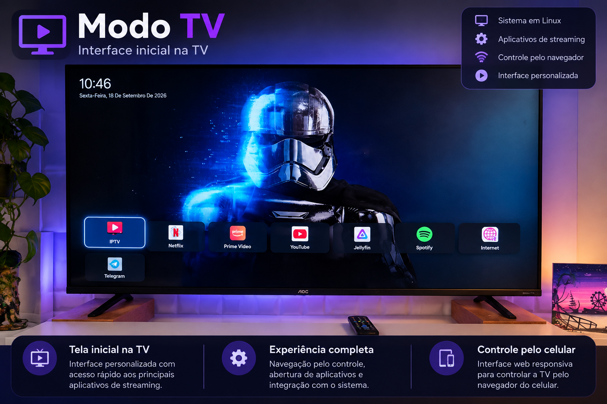
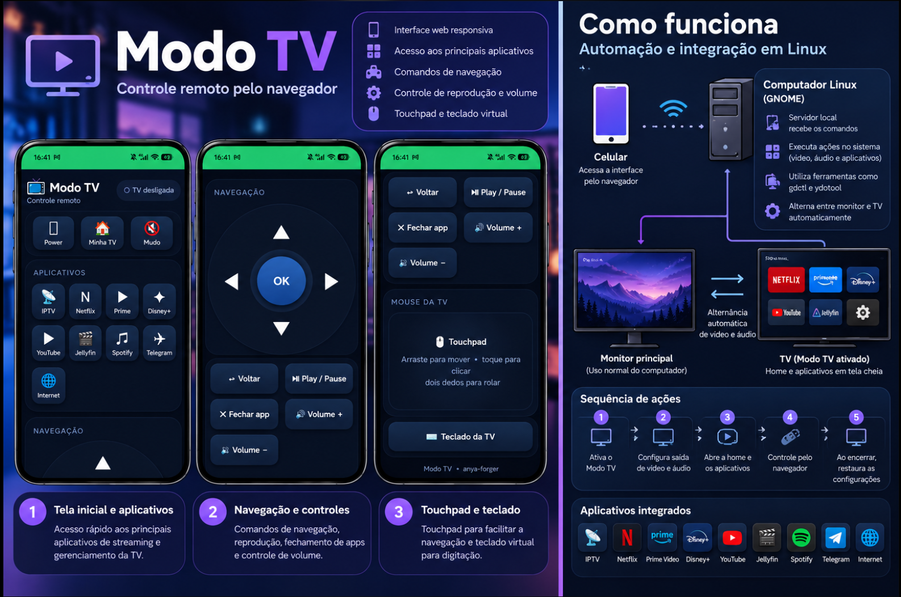
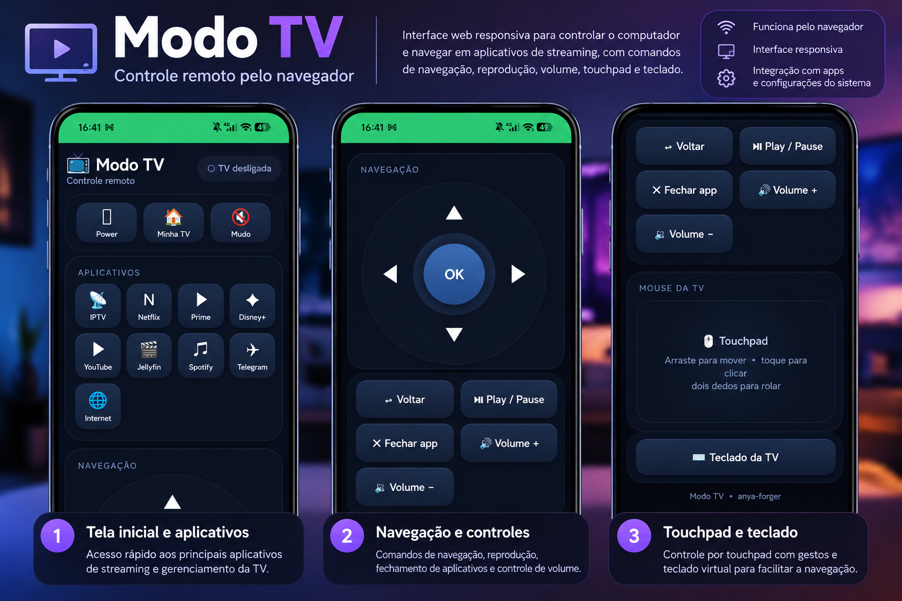
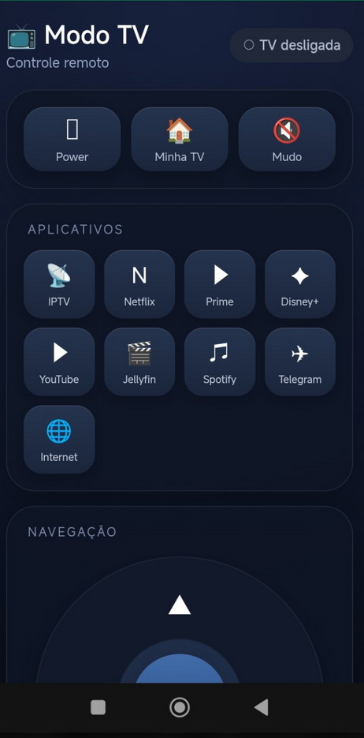
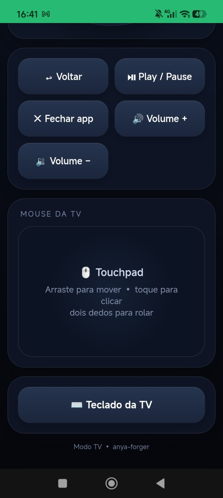
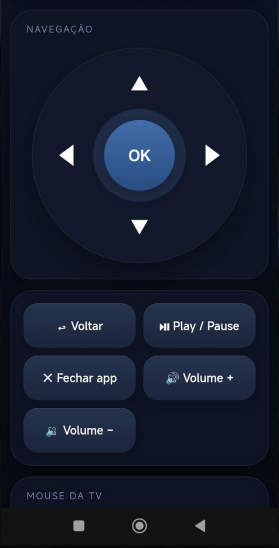

# Modo TV Linux

### Automação de ambiente multimídia no GNOME com Wayland

Estudo de caso de um projeto pessoal desenvolvido para transformar um computador Linux em uma central multimídia, utilizando uma televisão como segunda tela e um celular como controle remoto.

## Demonstração visual

### Apresentação do projeto

As imagens abaixo são composições visuais baseadas nas interfaces reais do Modo TV Linux.



<table>
  <tr>
    <td width="50%">
      
    </td>
    <td width="50%">
      
    </td>
  </tr>
</table>

### Capturas reais do controle remoto

As imagens seguintes mostram a interface do controle remoto funcionando no navegador do celular.

| Aplicativos e tela inicial | Touchpad e teclado | Navegação e controles |
| --- | --- | --- |
|  |  |  |

## Objetivo

Criar uma solução que permita alternar entre o ambiente de trabalho e um ambiente dedicado ao entretenimento, automatizando tarefas que normalmente exigiriam diversas configurações manuais.

O projeto surgiu de uma necessidade real e foi desenvolvido por meio de investigação técnica, testes, integração de ferramentas e resolução de problemas.

## Funcionalidades implementadas

- Ativação de um modo TV utilizando uma segunda tela.
- Alternância entre monitor principal e televisão.
- Direcionamento automático do áudio para a saída HDMI.
- Abertura de aplicativos e serviços de entretenimento.
- Interface de navegação adaptada para televisão.
- Controle remoto pelo navegador do celular.
- Comandos de navegação, teclado e controle de mídia.
- Retorno ao ambiente de trabalho com restauração das configurações.
- Integração com serviço de usuário do systemd.

## Tecnologias utilizadas

| Tecnologia | Aplicação |
|---|---|
| Linux | Ambiente operacional |
| GNOME / Wayland | Gerenciamento da sessão gráfica |
| Bash / Shell Script | Automação de comandos e processos |
| Python | Servidor local e integração de funcionalidades |
| HTML, CSS e JavaScript | Interfaces da Home e do controle remoto |
| systemd | Gerenciamento do serviço |
| Flatpak | Execução de aplicativos |
| PipeWire / ferramentas de áudio | Seleção da saída de som |

## Arquitetura da solução

O sistema integra três componentes principais:

**1. Automação do ambiente**

Scripts responsáveis pela configuração dos monitores, seleção do dispositivo de áudio e gerenciamento dos aplicativos.

**2. Servidor de controle**

Aplicação Python responsável por receber requisições e encaminhar comandos aos scripts do sistema.

**3. Interfaces web**

Uma interface visual para a televisão e um controle remoto acessível pelo navegador do celular.

### Fluxo simplificado

Celular → Interface web → Servidor Python → Scripts Bash → GNOME / aplicativos

## Desafios técnicos

Durante o desenvolvimento, foram trabalhados desafios como:

- Automação de monitores em uma sessão Wayland.
- Gerenciamento de janelas e aplicativos no GNOME.
- Integração entre comandos do sistema e interfaces web.
- Seleção e restauração da saída de áudio.
- Organização dos scripts para execução coordenada.
- Diagnóstico e correção de comportamentos inesperados.

## Documentação técnica

Este repositório reúne o código da versão pública do Modo TV Linux, a documentação técnica e as explicações sobre as soluções desenvolvidas.

### Guias disponíveis

- [01 — Gerenciamento de monitores no GNOME com Wayland](docs/01-gerenciamento-monitores.md)
- [02 — Automação de áudio HDMI no Linux](docs/02-gerenciamento-audio.md)
- [03 — Arquitetura e integração entre Python e Bash](docs/03-arquitetura-integracao.md)
- [04 — Desafios técnicos e soluções adotadas](docs/04-desafios-tecnicos-e-solucoes.md)

Os guias demonstram os desafios enfrentados, as ferramentas utilizadas e as decisões técnicas adotadas.

A documentação não contém configurações pessoais da instalação original.

## Exemplos de código

- [Alternância de monitores com Bash](exemplos/alternar-monitor.sh)

O exemplo demonstra a construção parametrizada dos comandos `gdctl` para alternar entre monitor e televisão.

Por segurança, o script é demonstrativo: imprime os comandos, mas não modifica a configuração dos monitores.

Este repositório também disponibiliza, na pasta `app/`, o código da versão pública do Modo TV Linux, adaptado para configuração em outros computadores com GNOME e Wayland.

## Como configurar e executar

O código da versão pública está disponível na pasta [`app/`](app/).

### Requisitos

- Linux com GNOME em sessão Wayland.
- Python 3 e Bash.
- `gdctl` para gerenciar os monitores.
- `pactl` para controlar o áudio.
- `ydotool` para comandos de teclado e mouse.
- Firefox para a interface inicial.
- Flatpak e os aplicativos desejados.

### 1. Baixar o projeto

```bash
git clone https://github.com/Tailana-Mattos/modo-tv-linux.git
cd modo-tv-linux/app
```

### 2. Criar a configuração

```bash
cp config.example.json config.json
```

Edite o arquivo `config.json` com os dados do seu computador.

### 3. Identificar os monitores

```bash
gdctl show
```

Preencha `display.tv_output`, `display.tv_mode`, `display.pc_output`, `display.pc_mode` e `display.scale`.

As resoluções devem seguir o formato `1920x1080@60.000`, utilizando modos suportados pelos monitores.

### 4. Identificar os dispositivos de áudio

```bash
pactl list short cards
pactl list short sinks
pactl list cards
```

Preencha os campos da seção `audio` com os dispositivos e perfis correspondentes.

### 5. Configurar os serviços

Na seção `services`, informe os endereços dos servidores Jellyfin e IPTV, caso utilize esses recursos.

### Observações

A versão pública ainda não foi validada em outros computadores. Configure corretamente os monitores e o áudio antes de utilizar os comandos de alternância.

### 6. Iniciar o servidor

Dentro da pasta `app/`, execute:

```bash
python3 server-publico.py
```

O servidor permanecerá ativo nesse terminal. Para encerrá-lo, pressione `Ctrl+C`.

### 7. Ligar e desligar o Modo TV

Em outro terminal, dentro da pasta `app/`, execute:

```bash
bash modo-tv-gnome-publico ligar
```

Para retornar ao monitor principal:

```bash
bash modo-tv-gnome-publico desligar
```

Para consultar o estado:

```bash
bash modo-tv-gnome-publico status
```

### 8. Acessar o controle remoto pelo celular

Para permitir acesso pelo celular, configure `server.host` como `0.0.0.0` no `config.json` antes de iniciar o servidor.

Descubra o endereço IP local do computador:

```bash
hostname -I
```

Com o celular conectado à mesma rede local, abra no navegador:

```text
http://IP_DO_COMPUTADOR:8765/remote
```

Substitua `IP_DO_COMPUTADOR` pelo endereço IP do computador e `8765` pela porta configurada, caso tenha sido alterada.

**Atenção:** o servidor não possui autenticação. Não exponha sua porta à internet nem utilize redes públicas ou não confiáveis.

A versão pública ainda não foi validada em outros computadores.


---

## Segurança e privacidade

Os exemplos publicados não devem conter senhas, tokens, dados pessoais ou configurações privadas.

O controle remoto envolve comandos que interagem com o sistema operacional. Qualquer implementação que permita acesso pela rede deve incluir mecanismos adequados de autenticação e proteção da comunicação.

## Competências demonstradas

- Análise e resolução de problemas técnicos.
- Automação de processos.
- Administração e configuração de ambiente Linux.
- Integração entre sistemas e ferramentas.
- Desenvolvimento de soluções com Python e Shell Script.
- Testes, diagnóstico e documentação técnica.

## Status

Projeto pessoal funcional no ambiente original.

Código da versão pública disponível em `app/`, acompanhado de documentação técnica. A configuração e a execução em outros computadores ainda não foram validadas.

---

**Projeto desenvolvido por Tailana Mattos.**
